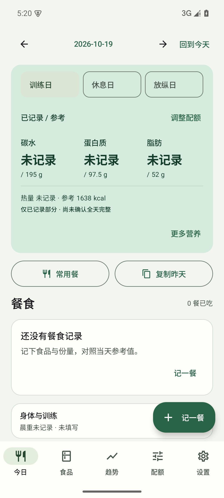
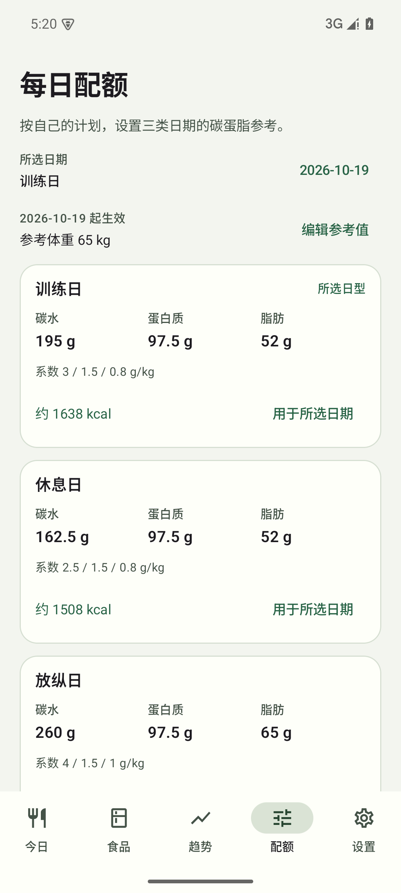
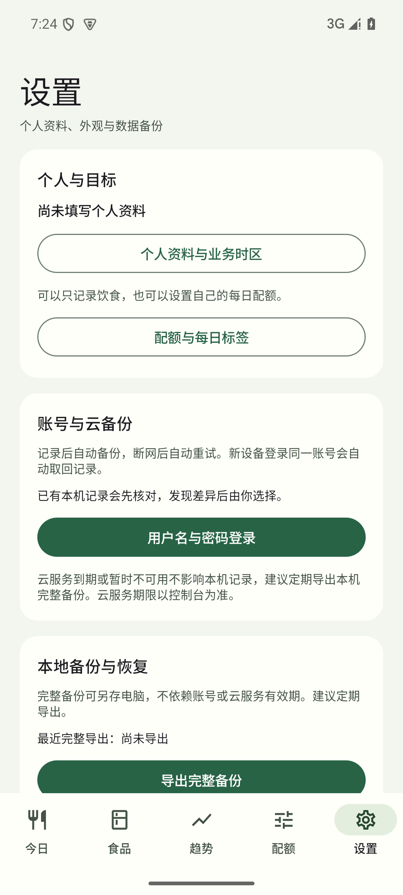

# 食记 · FoodLog Android

**原生 Android 饮食记录：离线记账、碳蛋脂参考与可选的跨设备云备份。**
**A native Android food diary with offline records, macro references and optional cross-device backups.**

[中文](#中文) · [English](#english) · [下载 / Downloads](https://github.com/lntanovo/foodlog-android/releases) · [更新记录 / Changelog](CHANGELOG.md)

[1.4.0 实现基线与开发交接 / Implementation baseline (中文)](docs/technical-implementation-1.4.0.zh-CN.md)

1.4.1：新增数据诊断、历史保护副本与恢复差异预览，详见 [1.4.1 测试与交付记录](docs/testing-1.4.1.md)。

1.4.1 adds diagnostics, recovery history and detailed restore comparisons. See [verification notes](docs/testing-1.4.1.md).

## 中文

食记使用 Kotlin、Jetpack Compose 和 Room 构建，支持 **Android 8.0 及以上**。日常记录保存在设备上，无需登录；登录后可自动云备份、换设备取回记录。当前版本 **1.4.1**。

### 能做什么

- **每日摄入与参考值**：首页查看碳水、蛋白质、脂肪的已记录量和当日参考值，热量简要展示，钠与纤维按需展开。
- **三类饮食日**：每天选择训练日、休息日或放纵日。按参考体重和自己填写的系数（g/kg）生成各类参考值，也支持直接填写克数；放纵日可只标记、不设参考值。
- **方便记餐**：保存常用餐、复制昨天的已吃餐食，先生成可修改的草稿，确认“保存已吃”后才计入摄入。支持份量单位等量换算。
- **自己的食品库**：搜索、收藏和自定义食品。标签更新创建新版本，历史餐食保留当时的营养快照；未知营养与真实零值分别记录。
- **身体与趋势**：记录晨重、腰围、实际训练及备注，查看 7 / 30 / 90 天趋势。补记或修改历史体重不会改变图表截止日期；顶部显示“截至”日期并可“回到今天”。曲线注明标准晨重点数，非标准称重仅保留在日期记录中，并有排除提示。
- **本地备份**：通过系统文件选择器导出 `.foodlog.gz` 完整备份、预览恢复或分享食品库；兼容旧版 JSON 导入。支持深浅色外观。
- **自动云备份**：登录后记录变更自动排队上传，连续修改合并成快照，断网后自动重试。新设备空白安装后登录同一账号会自动恢复；已有记录出现差异时先核对，保留历史版本，不自动合并冲突。首页和设置可查看备份状态。

<p>
  
  
  
</p>

截图使用 **65 kg 的合成测试计划**，用于演示界面；应用不内置这组个人数据或系数，也不会自动采用视频中的饮食配额。

### 下载与安装

| 版本 | 主要内容 | APK |
| --- | --- | --- |
| **[1.4.1](https://github.com/lntanovo/foodlog-android/releases/tag/v1.4.1)** | 数据诊断、历史保护副本、恢复差异与编辑保护 | **[下载最新版](https://github.com/lntanovo/foodlog-android/releases/download/v1.4.1/foodlog-1.4.1-debug.apk)** |
| **[1.4.0](https://github.com/lntanovo/foodlog-android/releases/tag/v1.4.0)** | 自动云备份、联网重试、新设备自动恢复、差异保护 | **[下载已发布 1.4.0](https://github.com/lntanovo/foodlog-android/releases/download/v1.4.0/foodlog-1.4.0-debug.apk)** |
| [1.3.0](https://github.com/lntanovo/foodlog-android/releases/tag/v1.3.0) | 可选账号、私有版本云备份、跨设备预览恢复、本机保护副本 | [APK](https://github.com/lntanovo/foodlog-android/releases/download/v1.3.0/foodlog-1.3.0-debug.apk) |
| [1.2.1](https://github.com/lntanovo/foodlog-android/releases/tag/v1.2.1) | 修复历史体重编辑截断趋势 | [下载 APK](https://github.com/lntanovo/foodlog-android/releases/download/v1.2.1/foodlog-1.2.1-debug.apk) |
| [1.2.0](https://github.com/lntanovo/foodlog-android/releases/tag/v1.2.0) | 三日型配额、首页摄入／参考、界面整理 | [下载 APK](https://github.com/lntanovo/foodlog-android/releases/download/v1.2.0/foodlog-1.2.0-debug.apk) |
| [1.1.0](https://github.com/lntanovo/foodlog-android/releases/tag/v1.1.0) | 可靠性修复、常用餐、复制昨天、压缩备份 | [下载 APK](https://github.com/lntanovo/foodlog-android/releases/download/v1.1.0/foodlog-1.1.0-debug.apk) |
| [1.0.0](https://github.com/lntanovo/foodlog-android/releases/tag/v1.0.0) | 首个离线记录版本 | [下载 APK](https://github.com/lntanovo/foodlog-android/releases/download/v1.0.0/foodlog-1.0.0-debug.apk) |

将 APK 下载到安卓手机，打开后按系统提示允许该安装来源。这些文件是**测试签名包**；本仓库发布的上述五个版本沿用同一签名，可覆盖安装并保留记录。请直接覆盖安装，勿先卸载或清除数据；更新前建议导出完整备份。自行构建的 APK 若签名不同，无法直接覆盖已安装版本。

首次安装只有 **11 种公共食品**，没有个人体重、餐食、配额或常用餐。下载同一 APK 不会共享彼此的数据。

### 怎么使用

1. **设置配额**：进入底部“配额”，填写参考体重。分别为训练日、休息日、放纵日填写自己选择的碳水、蛋白质、脂肪系数，或切换为直接填写克数。计算方式为 `每日克数 = 参考体重 kg × 系数 g/kg`，换算热量按碳水／蛋白质 4 kcal/g、脂肪 9 kcal/g 展示。
2. **保存计划**：确认生效日期后保存。参考体重独立于晨重，日常称重不会自动改变计划；保存新计划也不会批量改写已有日期的参考快照。需要更新某一天时，使用“用于所选日期”并确认。
3. **选择今天的日型**：回到“今日”，选择日期及训练日／休息日／放纵日，首页显示该日的摄入与参考。饮食日型独立于实际运动记录；某类未设配额时不会借用其他日型的数值。
4. **记录实际吃过的餐食**：选择食品、填写份量并保存已吃。可先从“食品”添加自己的营养标签；以后使用常用餐或复制昨天来生成草稿，再核对份量。草稿不计入摄入，份量留空表示待补。
5. **定期备份**：设置 → 导出完整备份，保存到自己选择的位置。恢复时先核对预览；完整恢复会替换当前业务数据，提交前会自动生成恢复前备份。新版备份建议用新版应用恢复。
6. **自动跨设备备份**：设置 → 账号与云备份，使用已开通的账号登录。记录修改后自动备份，换机前查看“记录已自动备份到云端”。新设备登录相同账号自动恢复；本机已有不同记录时先核对再选择。断网、省电限制或强行停止应用可能延迟上传，重新联网并打开应用会继续检查。详见[账号、到期与部署说明](docs/cloud-backup.md)。

### 电脑上体验

在 Android Studio 中创建并启动 Android 8.0+ 模拟器，然后把 Release 页面下载的 APK 拖入模拟器安装，或从 Android Studio 运行本项目。

仓库**不包含 SDK、系统镜像或预配置 AVD**。`一键测试食记.cmd` 对应原开发电脑的固定工具链与 `FoodLogTest` AVD，不能在全新电脑上直接自动配置环境；其他电脑请先自行安装 Android Studio 并配置模拟器。

### 构建与测试

使用 **JDK 17、Android SDK 35、Build Tools 35.0.0**。Android Studio 打开仓库目录后配置 SDK 路径；命令行构建前设置 `JAVA_HOME`，并在本地 `local.properties` 中设置 `sdk.dir`。Gradle Wrapper 已包含在仓库中。

```powershell
.\gradlew.bat assembleDebug
.\gradlew.bat testDebugUnitTest lintDebug
# 在独立测试模拟器中运行；仪器测试会修改测试设备上的应用数据。
.\gradlew.bat connectedDebugAndroidTest
python tools/test_migrate.py
```

macOS / Linux 使用 `./gradlew`。APK 生成在 `app/build/outputs/apk/debug/app-debug.apk`。

1.4.1 通过 **137 项单元与数据库测试**、26 项设备测试（另 3 项真实云参数测试跳过），并验证 1.2.0 和 1.4.0 同签名覆盖升级保留业务数据。最终显示调整后另外复跑 2 项新增页面测试。范围与限制见 [1.4.1 验收记录](docs/testing-1.4.1.md)。

历史版本 1.2.1 通过 65 项单元与数据库测试、3 组针对趋势的界面回归，验证从 1.2.0 覆盖升级保留记录。

历史版本 1.2.0 已在 Windows / Android 15 模拟器完成 **65 项单元与数据库测试、19 项界面测试、4 项 Python 迁移测试**，并验证同签名覆盖升级保留记录。实体手机和不同厂商系统尚未逐一验证。公开仓库不含个人迁移文件；依赖该文件的个人数据集成用例缺失时会跳过。详情见[验收记录](docs/testing.md)、[数据格式](docs/data-format.md)和[安装与签名](docs/release.md)。

### 隐私与项目状态

日常记录可完全离线使用，无分析统计。网络权限仅用于用户选择的 CloudBase 登录与云备份；手机保存加密令牌，不保存密码，APK 不含管理密钥。云备份不是端到端加密，环境管理员有管理权限。完整备份包含个人记录，请私密保管并定期另存电脑。源码与 APK 不含私人工作簿、账号密码或个人完整备份。

尚未实现微信登录、自行注册、自动同步合并、条码、AI 识别、照片附件或 CSV 导出。仓库目前公开供查看，**尚未授予开源许可证**；公开可见不代表已授予修改或再分发许可。

## English

FoodLog is a **native food diary for Android 8.0+**, built with Kotlin, Jetpack Compose and Room. Everyday records work offline; signing in enables automatic cloud backups and recovery on another device. Current version: **1.4.1**.

### Features

- **Intake beside your reference**: see recorded carbohydrates, protein and fat against the selected day's reference values. Expand secondary nutrition details when needed.
- **Three day types**: choose a training, rest or indulgence day. Set your own macro factors in g/kg of reference weight, or enter daily grams directly. An indulgence day can be a label without a quota.
- **Faster meal entry**: save reusable meals or copy yesterday's posted meals into editable drafts. Only “Save as eaten” adds them to intake. Convert serving units while preserving equivalent quantities.
- **Your food library**: search, favorite and create foods. Updated labels create new versions; past meals retain their original nutrition snapshots. Unknown values remain distinct from zero.
- **Body records and trends**: log morning weight, waist, actual training and notes; view 7 / 30 / 90 day trends. Editing or adding a historical weigh-in preserves the chart end date. The header shows that date and offers a return to today. The chart states its standard morning-weight sample count; nonstandard weigh-ins stay in the date records with an explicit exclusion note.
- **Local backup**: export compressed `.foodlog.gz` backups, preview restores and share selected food definitions through the system file picker. Legacy JSON imports and light/dark themes are supported.
- **Automatic cloud backup**: signed-in changes queue automatically, rapid edits share snapshots and interrupted uploads retry. A pristine device restores after signing in to the same account. Divergent existing records require a choice; historical snapshots remain available and conflicts are not merged automatically. Today and Settings show progress.

The screenshots above use a **synthetic 65 kg test plan**. These personal values and macro factors are not bundled with the app. FoodLog does not prescribe the ratios shown in the reference video.

### Download and install

- **[Download 1.4.1 APK](https://github.com/lntanovo/foodlog-android/releases/download/v1.4.1/foodlog-1.4.1-debug.apk)** — diagnostics, recovery history, detailed restore comparisons and protection against edits after preview.
- [Download 1.4.0 APK](https://github.com/lntanovo/foodlog-android/releases/download/v1.4.0/foodlog-1.4.0-debug.apk) — automatic backups, network retries, new-device recovery and conflict protection.
- [Download 1.2.1 APK](https://github.com/lntanovo/foodlog-android/releases/download/v1.2.1/foodlog-1.2.1-debug.apk) — fix historical weigh-ins changing the trend end date; clarify the displayed range and sample count.
- [Download 1.2.0 APK](https://github.com/lntanovo/foodlog-android/releases/download/v1.2.0/foodlog-1.2.0-debug.apk) — day-type quotas, intake/reference display and a simpler interface.
- [Download 1.1.0 APK](https://github.com/lntanovo/foodlog-android/releases/download/v1.1.0/foodlog-1.1.0-debug.apk) — reliability fixes, reusable meals, copy yesterday and compressed backups.
- [Download 1.0.0 APK](https://github.com/lntanovo/foodlog-android/releases/download/v1.0.0/foodlog-1.0.0-debug.apk) — initial offline diary.

Open the downloaded APK on your Android phone and follow its installation prompts. These are **debug-signed test builds**. All five published versions share the same signing identity and support in-place updates. Do not uninstall or clear app data first; export a full backup before updating. A locally rebuilt APK signed with a different key cannot replace an installed published build directly.

A fresh install contains **11 public food definitions**, with no personal meals, body records, quotas or templates. Sharing the APK does not share your data.

### Getting started

1. **Set a quota**: open the bottom **Quota** tab, enter a reference weight and choose your own carbohydrate, protein and fat factors for each day type. Alternatively, enter grams directly. The calculation is `daily grams = reference weight in kg × factor in g/kg`; energy uses 4 kcal/g for carbohydrates/protein and 9 kcal/g for fat.
2. **Save the plan**: choose its effective date. Reference weight is separate from daily weigh-ins. A new plan preserves existing daily reference snapshots; use the explicit action to apply it to a selected date when you want to recalculate that day.
3. **Choose the day's label**: on **Today**, select a date and its training/rest/indulgence label. Intake and reference appear together. The dietary label does not alter actual training records, and a day type without a quota does not inherit another type's values.
4. **Log what you ate**: choose foods, enter quantities and save the meal as eaten. Add your own labels in **Foods**. Reusable meals and yesterday's meals create drafts for review; drafts do not count toward intake, and a blank quantity means it still needs filling in.
5. **Keep a backup**: use **Settings → Export full backup** and choose where to save it. Review the preview before restoring; a full restore replaces current business data and first creates an automatic pre-restore backup. Restore newer backups with the newer app.
6. **Automatic cross-device backup**: sign in under account/cloud backup settings. Changes back up automatically; check the cloud confirmation before switching devices. A pristine device restores when signing in to the same account. Divergent existing records require review. Offline operation, battery restrictions and force-stop can delay work; reconnect and reopen to continue checking. See [accounts, expiry and deployment](docs/cloud-backup.md#english).

The current application interface is in Chinese; the bold English tab names above describe the corresponding Chinese controls.

### Try it on a computer

Create and start an Android 8.0+ emulator in Android Studio, then drag a downloaded APK into it to install. You can also open and run the project in Android Studio.

This repository **does not bundle an Android SDK, system image or configured AVD**. The Windows `一键测试食记.cmd` launcher targets the original development computer's toolchain layout and `FoodLogTest` AVD; it does not set up a new computer automatically. Configure Android Studio and an emulator yourself on another machine.

### Build and test

Use **JDK 17, Android SDK 35 and Build Tools 35.0.0**. Configure the SDK in Android Studio, or set `JAVA_HOME` and a local `sdk.dir` entry in `local.properties` for command-line builds. The Gradle Wrapper is included.

```sh
./gradlew assembleDebug
./gradlew testDebugUnitTest lintDebug
# Use a dedicated test emulator: instrumentation tests modify its app data.
./gradlew connectedDebugAndroidTest
python tools/test_migrate.py
```

On Windows use `.\gradlew.bat`. The APK is written to `app/build/outputs/apk/debug/app-debug.apk`.

Version 1.4.1 passed **137 unit/database tests** and 26 device tests (3 parameter-gated live-cloud cases skipped), with verified data-preserving upgrades from 1.2.0 and 1.4.0. The final display adjustment also passed 2 targeted device tests. See the [1.4.1 test record](docs/testing-1.4.1.md) for scope and limitations.

Historical version 1.2.1 passed 65 unit/database tests and 3 targeted trend UI groups, with a verified same-signature upgrade from 1.2.0.

Historical version 1.2.0 passed **65 unit/database tests, 19 emulator UI tests and 4 Python migration tests** on Windows with an Android 15 emulator. Same-signature upgrades were checked for data preservation. Physical phones and vendor-specific systems have not been exhaustively tested. Personal migration files are excluded from this repository; integration cases requiring those private fixtures skip when the files are absent. See the Chinese-language [test record](docs/testing.md), [data format](docs/data-format.md) and [installation/signing notes](docs/release.md).

### Privacy and project status

Everyday records work offline without analytics. Internet permission serves optional CloudBase sign-in and cloud backups. Tokens are encrypted locally; passwords are not stored, and administrator secrets are absent from the APK. Cloud backups are not end-to-end encrypted: environment administrators have management access. Keep full backups privately and export independent copies to your computer. This repository and its APKs contain no personal credentials, workbooks or full backups.

WeChat login, self-registration, automatic synchronization/merging, barcode scanning, AI recognition, photo attachments and CSV export are not implemented. The source is public for viewing, but **no open-source license has been granted yet**. Public visibility does not grant permission to modify or redistribute the project.
