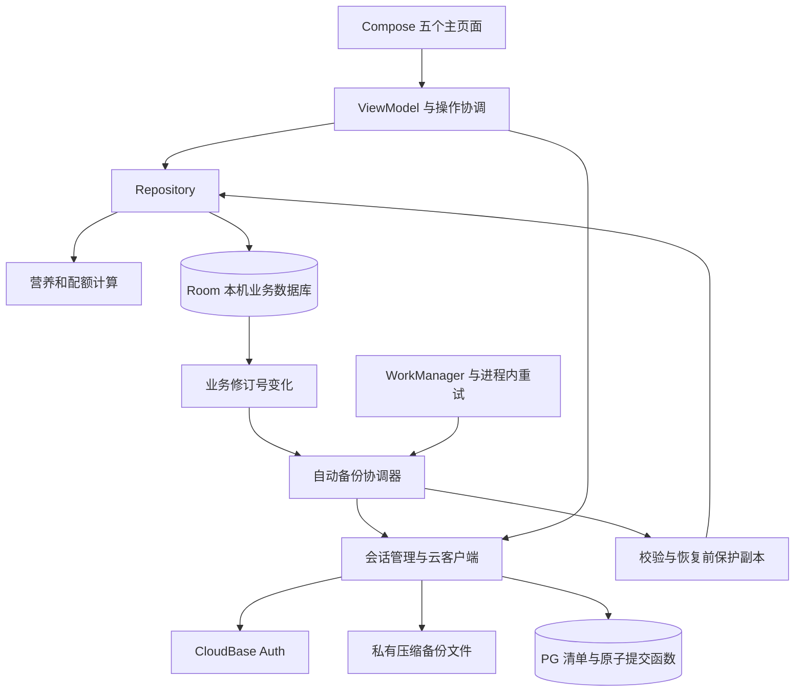

# 食记 Android：当前实现与开发交接技术文档

编制日期：2026-10-28（Asia/Shanghai）<br>
应用版本：1.4.0 / versionCode 7<br>
实现基线：Git 提交 `9b5442473f52e21daa225f1e6e924e233d6eec47`，标签 `v1.4.0`<br>
适用对象：项目所有者、后续开发者、测试人员与接手项目的开发助手。

本文依据当前源码、迁移文件、发布校验记录及已有验收记录整理，描述已经交付的实现。2026-10-28 本次工作为文档整理，没有重新执行整套测试或查询实时云端数据；最近一轮完整验收记录日期为 2026-10-20。

## 1. 项目目标与交付状态

食记用于记录餐食、计算营养摄入、管理个人碳蛋脂参考值，并保存身体记录与体重趋势。采用原生 Android 实现；离线可用，登录为可选功能。

当前数据流程为：**先保存本机 → 登录后自动备份 → 空白新设备登录相同账号后自动恢复**。出现两端不同修改时，需要核对并选择保留哪一份，不会自动逐条合并。

| 用户任务 | 当前实现 | 主要边界 |
| --- | --- | --- |
| 记录餐食与每日碳蛋脂 | 已完成 | 草稿不计入已吃；未知值不按零处理 |
| 自定义食品与份量换算 | 已完成 | 克与毫升互换需要明确密度 |
| 常用餐、复制昨天 | 已完成 | 生成新草稿，确认后才计入摄入 |
| 训练日、休息日、放纵日 | 已完成 | 饮食标签独立于实际运动记录 |
| 按体重系数或直接克数设置配额 | 已完成 | 用户自行选择系数；不内置截图中的经验配额 |
| 首页显示摄入与当日参考值 | 已完成 | 缺失配额不借用其他日型；未知摄入保留待补提示 |
| 体重、腰围及趋势 | 已完成 | 曲线与均值使用标准晨重；历史编辑不改变图表截止日期 |
| 简化界面、深浅色外观 | 已完成当前版本整理 | 主界面为中文，README 为中英双语 |
| 本地备份、恢复、食品库分享 | 已完成 | 完整恢复是替换；食品库分享不含餐食和身体资料 |
| 用户名、密码登录 | 已完成 | 账号由环境管理者预置；用户在手机手动输入 |
| 自动云备份、换机恢复 | 已完成 | 上传受联网和后台调度影响；换机前应检查成功状态 |
| 新版覆盖安装 | 已完成模拟器验证 | 包名与签名保持一致；不应先卸载或清除数据 |
| GitHub 源码与各版本下载 | 已完成至 1.4.0 | 历史版本各有标签和 APK |
| 打开软件询问升级／自动安装新版 | 未实现 | 自动云备份不等于应用版本自动更新 |
| 自行注册、微信登录、应用内修改密码 | 未实现 | 当前使用预置用户名密码账号 |
| 双设备冲突自动合并、CSV、识别、照片附件 | 未实现 | 作为后续独立任务评估 |

首次安装仅初始化 11 种公共食品，不写入个人餐食、体重、配额或账号。原始需求文档是历史规格，不能将其中全部计划项视为当前已实现功能。

## 2. 版本、技术栈与运行环境

| 项目 | 当前值 |
| --- | --- |
| 名称／applicationId | 食记／`com.foodlog.app` |
| 最低 Android | Android 8.0，API 26 |
| compileSdk／targetSdk | 35／35 |
| 语言与界面 | Kotlin 2.1.20、Jetpack Compose、Material 3 |
| Compose BOM | 2025.04.01 |
| 数据持久化 | Room 2.7.1，数据库结构版本 2 |
| 状态与异步 | ViewModel、StateFlow、Coroutines |
| 外观偏好 | DataStore Preferences 1.1.4 |
| 后台任务 | WorkManager 2.10.1 |
| JSON | Kotlin Serialization 1.8.1 |
| 构建 | AGP 8.9.2、Gradle Wrapper 8.11.1、KSP 2.1.20-1.0.32 |
| JDK／SDK Build Tools | JDK 17／35.0.0 |
| 云端 | 腾讯云 CloudBase 用户认证、PostgreSQL、私有文件存储 |
| 网络实现 | 原生 HTTPS HTTP 客户端，使用用户令牌访问云服务 |

版本号以 `app/build.gradle.kts` 为准，依赖版本以 `gradle/libs.versions.toml` 为准。这里记录本项目固定使用的版本，不表示它们是平台最新版本。

## 3. 工程结构与职责

```text
android-app/
  app/src/main/java/com/foodlog/app/
    App.kt                         Application、Room 和云协调器初始化
    MainActivity.kt                单 Activity、页面入口与交互忙碌保护
    domain/
      Models.kt                    业务模型、Dataset 与序列化结构
      NutritionCalculator.kt       营养、单位、配额与体重窗口计算
    data/
      Database.kt                  Room 实体、DAO、显式迁移
      Repository.kt                业务写入、快照、导入导出及恢复事务
      Validation.kt                文件与业务一致性校验
    ui/
      TodayScreen.kt               当日摄入、日型、餐食、云状态
      MealScreen.kt                记餐与草稿编辑
      FoodsScreen.kt               食品库与食品编辑
      TrendScreen.kt               身体记录与趋势
      QuotaScreen.kt               三日型参考配额
      SettingsScreen.kt            资料、外观、本地文件、账号入口
      AppViewModel.kt              主要业务界面状态
      TransferViewModel.kt         本地文件任务及中断状态
      CloudBackupViewModel.kt      登录与手动云备份交互
      CloudBackupSection.kt        云备份状态、核对与操作界面
    cloud/
      CloudAuth.kt                 登录、令牌刷新、退出接口
      CloudSessionStore.kt         Keystore 加密的会话落盘
      CloudSessionManager.kt       账号身份、登录代次及刷新串行化
      CloudHttp.kt                 HTTPS 请求和错误处理
      CloudContracts.kt            环境配置、云清单模型与约束
      CloudBackupClient.kt         上传、清单、下载及原子提交
      CloudBackupStaging.kt        手动云传输任务与恢复预览
      AutomaticBackup.kt           自动备份状态机、指纹与持久化日志
      AutomaticBackupScheduler.kt  后台 Worker、直接执行与联网触发
  app/src/main/assets/foods_seed_v1.json
  app/schemas/                     Room v1、v2 结构快照
  app/src/test/                    计算、Room、会话、传输和状态机测试
  app/src/androidTest/             Android 界面与设备集成测试
  cloudbase/migrations/             版本化 PostgreSQL 迁移
  specs/                           账号备份、自动备份的需求与设计
  tools/                           旧数据转换、电脑启动等辅助工具
  docs/                            数据、测试、部署、发布及本文档
```

依赖方向为 UI → ViewModel／协调器 → Repository／计算服务／云客户端。业务写入由 Repository 统一约束；界面不直接更改 SQL 表。自动执行与后台 Worker 共享同一个自动备份引擎和互斥锁。



## 4. 页面与核心业务规则

### 4.1 页面组织

底部导航为 **今日、食品、趋势、配额、设置**。今日页突出日期、日型、碳水／蛋白质／脂肪的摄入与参考值、记餐入口和餐食列表。钠、纤维等次要指标按需展开。配额使用独立底部入口，避免将复杂设置挤入首页。

### 4.2 餐食、草稿与食品快照

- 餐食状态分为 `DRAFT` 和 `POSTED`；仅已确认的 `POSTED` 计入当日摄入。
- 编辑已有餐食时使用独立草稿，并以 `replacesMealId` 关联原餐；确认后通过事务替换，不重复累计。
- 未输入份量使用 `null`；未完成文本如 `60.` 可保存在草稿中，不能当作有效已吃数量提交。
- 食品标签修改创建新的不可变版本。历史餐食和常用餐保留保存时的名称、份量、营养快照，不随食品当前标签自动改写。
- 常用餐和复制昨天均创建新的餐食及条目 UUID。复制来源为所选日期前一自然日的已吃餐食，不复制草稿。
- 删除撤销包包含原餐、相关编辑草稿及导入来源；撤销在事务中恢复。

### 4.3 数值、单位和能量

业务计算采用 `BigDecimal`，除法使用 `DECIMAL128`；数据库 JSON 与备份中保存规范十进制字符串，显示时才舍入。

```text
单项营养 = 食品基准营养 × 本次归一数量 ÷ 基准数量
系数模式每日克数 = 参考体重 kg × 用户设置系数 g/kg
配额热量 kcal = 蛋白质 g × 4 + 碳水 g × 4 + 脂肪 g × 9
```

食品热量优先级为：标签 kcal → 标签 kJ ÷ 4.184 → 食品平均估算热量 → 三大营养齐全时按 4/4/9 估算。不会用宏量估算强行替代已有标签能量。

份量单位通过食品定义换算。克和毫升不自动等同，跨单位需要明确密度；估算份量切换成克后仍保留估算属性，直到实际重新输入测量数量。未知营养与真实零值分开；汇总显示已知合计及缺失项，不用未知值推算精确剩余额度。

### 4.4 三日型与配额快照

- `TRAINING`、`REST`、`FLEX` 分别表示训练日、休息日、放纵日，独立于当天实际训练类型。
- 支持 `PER_KG` 系数模式和 `DIRECT_MACROS` 直接克数模式；参考体重独立于晨重。
- 放纵日可仅打标签、不配置参考值；未配置时不借用训练日配额。
- 每次修改保存新的计划，按生效日期选择可用计划；每日目标保存为快照。
- 新计划不会批量改写历史目标。明确选择“用于所选日期”时只重算该日。

### 4.5 体重趋势

支持 7／30／90 天查看范围。标准晨重参与曲线和均值，非标准称重保留在日期记录中并提示排除。窗口均值只用实际有效记录，不补造缺测体重；两个相邻七日窗口均各有七条有效记录时才提供窗口变化值。

1.2.1 已修复“编辑较早体重后，曲线截止日期跟随变早”的问题。趋势页独立保留截止日期，并提供“回到今天”；修改某一天记录不会自动缩短显示范围。

## 5. 本机数据与备份文件

### 5.1 Room 数据库

数据库文件名固定为 `foodlog.db`。各业务聚合以独立行保存，正文为版本化 JSON；这不是食品营养每个字段各占一列的完全关系化结构。

| 表 | 主键 | 内容 |
| --- | --- | --- |
| `foods` | id | 食品身份、收藏与当前版本引用 |
| `food_versions` | id | 不可变标签、营养、份量和密度 |
| `meals` | id | 草稿／已吃餐食及条目快照 |
| `day_logs` | date | 饮食日型、训练、完整性与备注 |
| `body_records` | date | 体重、腰围及标准称重属性 |
| `target_plans` | id | 配额计划、生效日期与三类设置 |
| `day_targets` | date | 当日配额快照 |
| `meal_templates` | id | 常用餐快照 |
| `import_origins` | namespace + sourceKey | 旧数据来源、去重和冲突审计 |
| `metadata` | id | datasetId、时区、个人资料与修订号 |

当前 Room v2；`MIGRATION_1_2` 仅新增 `meal_templates`，保留旧表。不配置破坏性清库回退。业务修改通过事务更新并递增修订号，供界面刷新与自动备份观察。

### 5.2 手机上具体保存在哪里

以下是普通 Android 用户空间中的典型路径，以系统提供的应用目录为准；工作资料等空间可能不同。它们属于应用私有目录，普通文件管理器通常看不到。

| 数据 | 典型路径／接口位置 |
| --- | --- |
| 主要餐食、身体和配额记录 | `/data/user/0/com.foodlog.app/databases/foodlog.db`，运行时可能伴随 WAL 文件 |
| 自动备份关联与队列 | `files/automatic-cloud/state.json` 及对应 UUID 的 `.foodlog.gz` |
| 完整恢复前保护副本 | `files/recovery/before-restore-*.json.gz` |
| 本地文件任务 | `files/transfers/` |
| 手动云传输任务 | `files/cloud-transfers/` |
| 加密登录会话 | `Context.noBackupFilesDir/cloud-session/session.enc` |
| 界面外观偏好 | `ui_preferences` DataStore |
| 用户导出的完整备份 | 系统文件选择器中由用户指定的位置，没有固定下载目录 |

1.3、1.4 仍沿用同一个本地数据库，不会因为加入账号功能就将本机记录迁走。登录账号也不代表此前所有本机内容已经成功上传。APK 只包含程序和公共种子食品，不包含使用后的记录。

应用关闭 Android 系统自动备份（`allowBackup=false`）；业务恢复使用应用自己的导出和云备份。卸载或清除数据会删除应用私有目录，本机保护副本不能替代另存到外部的独立备份。

### 5.3 可移植业务文件

完整备份为 `.foodlog.gz`，内容是 GZIP 压缩的 UTF-8 JSON，当前 `schemaVersion=3`。按文件内容识别压缩格式，兼容旧 JSON 与 v1／v2 业务备份，拒绝未来格式版本。

| kind | 用途 |
| --- | --- |
| `FULL_BACKUP` | 完整业务数据，恢复时替换本机业务实体 |
| `FOOD_LIBRARY` | 仅分享所选食品及当前营养版本，不携带个人记录 |
| `LEGACY_IMPORT` | 电脑转换的旧记录，经预览后增量导入并处理日期冲突 |

完整备份包括草稿、常用餐、食品历史版本、个人资料和配额；不含登录凭据、自动队列关联、界面外观设置或照片附件。业务日期为 ISO 日期，时间为 UTC Instant；时区保存在 metadata，切换时区不重新排列旧记录日期。

本地编解码上限为解压后 JSON 256 MiB。校验覆盖版本、重复 ID／日期、数值、引用、单位及派生营养一致性，先验证再写入。

## 6. 账号、自动云备份与换机

### 6.1 服务组成与配置

使用已获授权的既有 CloudBase 环境，应用业务与环境内其他应用分表存储。环境网关写在 `CloudContracts.kt` 的 `CloudConfig` 中；环境标识是客户端路由配置，不是管理密钥。

- Auth：用户名密码登录、访问令牌、刷新令牌及退出。
- PostgreSQL：`public.foodlog_backups` 保存每个备份的清单和摘要。
- 私有存储：桶 `foodlog-backups`，对象路径为 `{uid}/{backupUuid}.foodlog.gz`。
- 当前客户端只使用普通用户令牌；没有腾讯云管理员 SecretId／SecretKey。

每份云备份为完整快照，不是逐条餐食的实时数据库同步。清单包含备份 UUID、服务端归属和创建时间、对象路径、SHA-256、字节数、应用／格式版本、设备名、datasetId、记录数量、日期范围和本机修订号。跨设备新旧按服务端顺序判断，不能比较两台设备的本机 revision 数字大小。

### 6.2 自动执行和离线重试

1. Application 初始化协调器，观察登录身份及 `datasetId + revision` 的变化。
2. 保存记录后请求备份，普通修改安排约 4 秒初始等待；相同内容通过指纹去重，连续操作可合并为快照。
3. WorkManager 保存联网约束的一次性任务，指数退避从 10 秒起，并安排 15 分钟周期的补偿检查；实际执行时机由 Android 调度。
4. 登录、进入应用和网络变化时再次检查。进程内合并队列直接尝试实际 HTTPS 端点，兼容国内服务可达但 Android 网络验证未通过的情况。
5. 进程内重试从 10 秒指数增加，最大 15 分钟；它与 WorkManager 共用引擎互斥锁和日志，不会同时提交两次恢复。
6. 后台输入只保存 UID 和登录代次，不保存令牌、密码或业务正文。退出或切换身份后，旧代次任务不能继续按新账号执行。

处于餐食编辑、手动云传输或本地文件任务期间，协调器会延后自动处理，避免争用恢复流程。联网、登录成功、界面显示“等待”均不等于云备份已完成，应查看成功状态与最近备份时间。

### 6.3 持久化状态与上传幂等

`AutomaticBackupEngine` 的原子日志记录账号关联、已知云端最新 UUID、已确认内容指纹、待传不可变快照和恢复意图。业务指纹使用 SHA-256 流式编码，忽略导出时间、应用版本、revision、lastExport 及实体集合顺序；实际字段、删除、草稿和餐内条目顺序仍参与比较。

准备上传时先写 `.partial`，同步文件、原子移动，重新读取备份生成真实摘要后保存待传日志。请求失败或成功响应丢失时复用**相同 UUID 和相同字节**，避免重复新增。对象上传成功但清单提交冲突时，不将它显示为新的成功备份；对象与清单分两步写入，并不是跨存储系统的单一事务。

### 6.4 自动恢复与差异决策

| 本机／云端情况 | 处理方式 |
| --- | --- |
| 真正空白安装，云端有完整备份 | 下载、完整校验、写保护副本后自动恢复 |
| 本机与云端内容相同 | 建立／更新关联，不生成重复快照 |
| 已关联，本机没有待传修改，云端有新版本 | 通过身份与修订校验后可自动取回 |
| 本机有修改，云端仍为已知版本 | 新增本机完整备份 |
| 本机与云端都有不同修改 | 暂停并提示核对，不自动合并 |
| 首次登录已有记录，内容与云端不同 | 用户核对后选择用云端或保留本机并新增备份 |
| 切换账号且本机有原关联记录 | 提示差异，不自动传给另一账号 |
| 云端没有备份 | 不据此清空本机；符合关联检查时可备份本机 |

“空白”不仅指没有餐食：必须与公共种子库一致，且没有个人资料、自定义／收藏食品及其他个人改动。完整合法空备份与“云端没有备份”是不同情况，不能混淆。

手动历史版本预览与恢复继续保留。选择“保留本机”会新增一个版本，旧云备份继续存在；若本机可能缺记录，应先核对数量和日期，不能一概选择本机。

### 6.5 云端原子提交与权限

两份已实施的版本化迁移：

1. `20261019051410_foodlog_cloud_backups.sql`：备份清单、约束、私有存储与按用户隔离权限。
2. `20261020070000_foodlog_automatic_backup.sql`：原子比较后新增函数及同账号插入串行化触发器。

自动提交调用 `public.foodlog_commit_backup(payload jsonb, expected_head uuid)`。函数为 `SECURITY INVOKER`，使用服务端 `auth.uid()`，受现有用户 RLS 限制；匿名不可执行，已认证用户仅操作自己的记录。

同账号事务锁内先检查 UUID 是否已提交：存在则返回原记录；否则比较最新云端 UUID 与 `expected_head`。匹配才新增清单，不匹配返回 conflict。触发器也串行化旧版／手动清单插入并分配单调服务端时间；旧客户端仍兼容，但不具备新版自动提交的全部差异决策能力，建议两端均使用 1.4。

普通应用用户可新增、读取自己的清单与文件，不能覆盖旧对象或更新／删除历史清单。上传为历史版本累积，尚无面向用户的自动清理和保留数量策略。

## 7. 数据保护、安全与故障边界

### 7.1 恢复提交顺序

```text
下载／读取 → 大小与 SHA-256 核对 → 解压与业务校验
→ 展示预览或满足安全自动恢复条件
→ 锁内核对账号、登录代次、datasetId 与 revision
→ 写恢复前临时副本 → fsync → 完整解析验证 → 原子移动
→ 单个 Room 事务替换业务数据
```

云文件上限 64 MiB 压缩、256 MiB 解压；同时核对所有者、格式、数量和日期摘要。签名下载地址校验 HTTPS、目标主机和路径，不转发 Bearer 令牌、不跟随重定向。

恢复意图持久化不等于无条件再次覆盖授权。重启后比较实际业务内容与旧修订，重新判断是否已完成或发生新编辑；手动恢复中断也需重新核对。登录、退出、密码错误和云服务故障都不调用清空业务记录。

### 7.2 凭据与备份隐私

访问／刷新令牌通过 Android Keystore 加密并原子保存，刷新串行化。密码不落盘，不写入 APK、Git 或业务备份。首次登录仍需用户自行输入已开通账号的用户名和密码。

备份通过 HTTPS 传输，云端按用户隔离；**不是端到端加密**，环境管理员仍有管理权限。导出文件包含个人记录，应自行私密保管。本文不收录真实密码、用户令牌、个人记录或私有账号说明文件。

### 7.3 覆盖安装与云服务可用性

覆盖安装需要 applicationId、签名一致且 versionCode 合法递增。当前发布为同一测试签名链，1.3→1.4 已在隔离模拟器验证逐表保留。应直接覆盖安装，避免先卸载或清除数据；正式签名和迁移链路需另行规划，不能更换签名后要求用户卸载来解决。

云服务套餐的有效期、额度和费用应以控制台实时状态为准；本文没有再次查询这些值。停服会影响上传和下载，已保存的手机本地数据不依赖云服务。应定期导出独立文件，不能将私有恢复副本或单个云环境视作永久保管方案。

后台省电限制、强行停止和厂商调度可能延迟上传；保存成功只表示本机提交完成。换机、清数据或卸载前应确认云备份成功，并另存可预览的完整文件。

## 8. 已有测试证据与尚未解决的问题

最近验收环境：2026-10-20，Windows、JDK 17、SDK 35、两台独立 Android 15 模拟器。以下来自已有记录，不表示本次文档工作重新执行。

| 项目 | 已记录结果 |
| --- | --- |
| 单元／数据库 | 128 项通过，0 失败 |
| 构建与静态检查 | 主 APK、测试 APK 构建成功；Lint 0 错误、2 条已有 KTX 风格警告 |
| 默认仪器测试 | 27 个用例中 24 通过、3 个需参数云测试跳过，无失败 |
| 独立真实云仪器执行 | 5 次：自动上传、离线保存、重开补传、第二设备恢复、真实登录界面恢复 |
| 云端并发 | 两轮竞争各 1 成功／1 冲突；同 UUID 重试幂等；匿名提交拒绝 |
| 同签名升级 | 1.3 code 6→1.4 code 7，重启后各业务表内容一致，Room 仍 v2 |
| 升级合成记录 | 包括 2 餐食、4 身体记录、1 常用餐及食品、日期、配额和来源记录 |
| Python 转换 | 4 项通过 |
| 测试清理 | 合成账号、对象、清单和临时清理权限均已移除 |

真实云五次仪器流程完成后，最终构建还加入了进程内 RETRY 的延迟重试调度；随后单元测试、构建和 Lint 通过，没有据此宣称再次完成全部真实云流程。

**尚未解决的实际问题：**此前用户报告 vivo 手机从约 1.2 直接覆盖安装后，餐食历史不见，但身体／配额仍在。尚未取得该手机的原始导出文件，原因未确定；模拟器升级通过不能证明该问题已经修复。后续应先取得新的完整导出及可用恢复前副本，检查 meals、状态、日期、datasetId 和云端历史数量，保留原文件再判断；不要先卸载、清数据或盲目恢复。

尚未覆盖实体 vivo、其他厂商后台策略、Android 8–14 的完整设备矩阵、实际磁盘耗尽和硬件断电。详细证据见 [测试验收记录](testing.md)。

## 9. 构建、电脑测试与发布交接

### 9.1 通用构建

Android Studio 打开仓库目录，配置 SDK 35 与 JDK 17。命令行设置 `JAVA_HOME`，本地 `local.properties` 配置 `sdk.dir`；不要把个人路径、密钥或令牌提交到 Git。

```powershell
# 在 android-app 目录执行
.\gradlew.bat assembleDebug
.\gradlew.bat testDebugUnitTest lintDebug
python tools/test_migrate.py

# 仅使用独立测试设备；仪器测试会修改应用测试数据
.\gradlew.bat connectedDebugAndroidTest
```

APK：`app/build/outputs/apk/debug/app-debug.apk`。报告：`app/build/reports/tests/testDebugUnitTest/`、`app/build/reports/androidTests/connected/debug/`、`app/build/reports/lint-results-debug.html`。公开仓库不含私有迁移夹具，相应可选用例可能跳过；不能把跳过写成通过。

真实云测试需要明确参数和独立合成账号，不能默认使用日常账号。之前的临时测试账号已删除，不能复用旧凭据直接复跑。

### 9.2 电脑上启动

现有 `一键测试食记.cmd` 与 `tools/start-emulator.ps1` 面向原开发电脑的工具链和 `FoodLogTest` AVD，保留该模拟器既有记录。其他电脑应先安装 Android Studio、SDK 和系统镜像，再创建 Android 8.0+ 模拟器；脚本不自动为新电脑安装全部环境。

日常体验设备与自动测试设备应分开，避免仪器测试改动正常记录。手机和电脑模拟器各有本地数据库，登录同一账号后按云备份规则传递数据，并不会直接共享电脑上的文件。

### 9.3 发布基线与后续版本

- 仓库：[lntanovo/foodlog-android](https://github.com/lntanovo/foodlog-android)。
- 当前发布：[v1.4.0](https://github.com/lntanovo/foodlog-android/releases/tag/v1.4.0)。历史 1.0.0、1.1.0、1.2.0、1.2.1、1.3.0 保留独立下载。
- 发布资产包括 `foodlog-1.4.0-debug.apk`、`foodlog-1.4.0-source.zip` 和 `SHA256SUMS.txt`。
- 1.4.0 APK 大小 `19,395,584` 字节，SHA-256：`8823cab21d21280ebd49307cb2a4c2e3963725fd329be13d93d6697834f87291`。
- 当前签名证书 SHA-256：`7fec875947abc24ddfcf9e864ea79487f4605de7562daa995221051b385e41e2`；保管签名文件，不将其公开。
- 每次版本升级递增 versionCode，执行数据保留验证，更新双语 README／CHANGELOG，创建对应标签并发布源码、APK、校验和，核对远端资产大小与摘要。
- 当前仓库公开，但未添加开源许可证；不因公开可见推定已授权修改或再分发。

1.4.0 没有应用内检查新版、弹窗更新、下载安装包或自动安装逻辑。后续如要实现，应先解决手机可访问的版本信息和 APK 下载地址，再设计校验及安装流程。

## 10. 建议的后续任务与验收条件

以下为建议，不代表已经实施或获得云资源购买授权。

| 顺序 | 任务 | 验收条件 |
| --- | --- | --- |
| 1 | 排查实体手机餐食异常 | 取得原始导出，定位缺失位置或形成可复现案例，提供明确恢复步骤 |
| 2 | vivo 与 Android 版本兼容回归 | 覆盖登录、保存、断网重连、省电、重启、覆盖升级和系统文件选择器 |
| 3 | 数据诊断与状态可读性 | 可查看本机／云端各项数量、最近成功时间及待传原因，不暴露凭据 |
| 4 | 云历史容量与维护方案 | 有容量观测和明确保留策略；删除需单独设计权限和恢复保护 |
| 5 | 账号自助能力 | 独立设计注册／改密／找回流程，验证身份校验与失败处理 |
| 6 | 需要时再做应用内更新 | 确认可达下载服务，校验版本与 APK，验证同签名覆盖安装保留数据 |

所有后续改动应保持：食品和餐食历史快照不静默重写、草稿不计入摄入、未知值不伪装为零、恢复前先保护、账号切换不误传、冲突不静默覆盖。

## 11. 配套资料

- [项目介绍与使用方法（中英双语）](../README.md)
- [版本更新记录](../CHANGELOG.md)
- [业务数据与备份格式](data-format.md)
- [账号、云备份与自行部署](cloud-backup.md)
- [测试验收记录](testing.md)
- [安装、签名与数据说明](release.md)
- [发布流程](RELEASING.md)
- [自动备份需求](../specs/automatic-cloud-backup/requirements.md)、[设计](../specs/automatic-cloud-backup/design.md)、[任务完成表](../specs/automatic-cloud-backup/tasks.md)
- [账号备份需求](../specs/account-cloud-backup/requirements.md)、[设计](../specs/account-cloud-backup/design.md)
